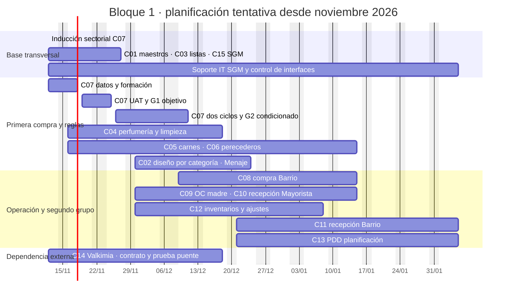

# Gantt tentativo de implementación y aceptación · Bloque 1

**Corte de planificación:** 05/11/2026, con revisión de dependencias al 09/11 por S37–S41. **Estado:** escenario para distribuir trabajo y negociar capacidad; no registra avance ni fija fecha de puesta en producción. El libro operativo es [v0.5](../outputs/20261105/DIARCO_Bloque1_Plan_v0.5.xlsx), con 15 circuitos, 30 registros individuales de formación y 75 casos específicos propuestos. El primer piloto es **C07 No Comestibles**. La aceptación funcional y el permiso de operar siguen siendo decisiones separadas por población, versión y circuito.

**Nueva restricción de fin de año (indicada el 09/11):** proponer desde el **15/12** una ventana sin cambios que puedan afectar la línea de cajas, sujeto a ratificación de IT y Operaciones DIARCO. Las barras de UAT posteriores a esa fecha son trabajo en TEST o preparación; **no autorizan por sí solas despliegues productivos, cambios en interfaces de cajas ni cortes de SGM**. Revisar dependencias de cada versión antes de fijar una ventana de producción.

**Asignaciones M05:** la hoja `Asignaciones` fue separada por frente el 09/11. Los nombres de C04/C06/C08 en la tabla de circuitos de este Gantt provienen de la foto anterior; usar la [conciliación M05](07_matriz_sector_circuito.md#actualización-de-asignaciones-m05--09112026) para la reunión y replanificar capacidad una vez aceptadas las funciones M04/M05. No inferir que una pareja resuelve ambos módulos.

## Calendario y supuestos de capacidad

- **09/11:** feriado nacional. El [Decreto 1103/2026](https://www.argentina.gob.ar/normativa/nacional/norma-430580/texto) también establece feriado el **10/11 en CABA y Córdoba** y el **11/11 en la provincia de Buenos Aires**. La reunión general de referentes está prevista para el 10/11 con recuperación para ausentes; se propone el **12/11** como primer día común para la reunión sectorial C07 y las entregas críticas, sujeto a confirmar agenda.
- **23/11:** reservar sin actividades conjuntas por el traslado del Día de la Soberanía, indicado en el [calendario oficial de referencia](https://www.argentina.gob.ar/sites/default/files/cronograma_de_licitaciones_2026.pdf). **07/12** se reserva como día no laborable turístico según la [Resolución 164/2025](https://www.argentina.gob.ar/normativa/nacional/norma-421799/texto); **08/12**, **25/12** y **01/01** tampoco se usan como días de prueba/aceptación.
- Se presupuestan **dos células funcionales de prueba**, con referentes DIARCO y facilitadores Zeetrex distintos, **una ventana compartida de IT/SGM** para interfaces/OC, y **una coordinación de formación** (CMZ). Es una hipótesis a confirmar; si sólo hay una célula funcional, habrá que serializar y mover las fechas. Como regla de agenda, máximo dos circuitos con UAT activo el mismo día y una sola prueba de emisión/integración de OC con efectos externos a la vez.
- La formación por frente tiene **60–90 minutos de introducción y pedido de datos**, devolución del set en 2–3 días hábiles, **taller con datos reales y práctica individual** del titular y suplente. Asistencia no equivale a aptitud. El mismo referente puede recibir datos de otro frente mientras se prueban circuitos anteriores, pero no se le asignan dos talleres o pruebas simultáneas.
- El plan supone casos y entorno preparados sin defectos bloqueantes nuevos. Cada corrección, reprueba o falta de datos ocupa capacidad y mueve el gate del circuito. Las horas cargadas en Asignaciones (6 h titular y 4 h suplente por semana por módulo) deben consolidarse **por persona real**, sin multiplicarlas por C07, C02 y C13 ni por M04/M05.

## Secuencia de cada frente

| Paso | Quién lo hace | Salida y condición de avance |
| --- | --- | --- |
| 1. Convocatoria e inducción | CMZ/ZF con dueño y referente DIARCO | Explicar circuito; elegir población; pedir proveedor/SKU/sucursal, lista, OC o movimiento real; confirmar titular, suplente y dueño de aceptación |
| 2. Entrega y saneamiento de datos | Referente y IT/SGM; Zeetrex verifica correspondencias | Set fechado y trazable; excepciones y faltantes con dueño; versión/ambiente y controles de efectos externos |
| 3. Esperado y criterio | Dueño de proceso; Compras/Impuestos/IT cuando aplique | Resultado por línea/estado/saldo aprobado, tolerancia y criterio de rechazo. Sin esperado aprobado, la UAT de ese caso no empieza |
| 4. Taller y práctica individual | ZF/CMZ enseña; titular y suplente operan | Normal y excepción demostrados por cada uno; material, FAQ y evidencia en `Formacion circuitos` |
| 5. UAT y reprueba | Usuario DIARCO ejecuta; ZF/ZT/IT acompañan | Casos `CC-*` registrados en `Ejecuciones circuitos` con observado, defecto, evidencia y nueva ejecución por reprueba; G1 sólo con los controles acordados |
| 6. Paralelo/piloto | Referente y usuario DIARCO con soporte L1/IT/L2 | Al menos dos ciclos completos, uno con excepción, y conciliación contra SGM/DIARCO en la población elegida; G2 cuando el dueño lo acepte |
| 7. Expansión y transferencia | Sponsor/IT/LD/LZ y dueño; mesa de ayuda | G3 por oleada autorizada; G4 tras cinco días operativos estables y transferencia de soporte, conforme al [método](02_metodo_gobierno_y_soporte.md) |

**Acoplamiento útil:** al iniciar la inducción de un frente se envía la ficha de datos y se fija su fecha de devolución. Mientras ese frente recopila datos, otra célula puede ejecutar UAT ya preparada. Los datos de un circuito no se consideran listos por haber asistido a la capacitación.

## Vista de calendario

Las barras muestran **ventanas de preparación y validación**, no fechas productivas. Los gates de la tabla siguiente mandan sobre la posición gráfica. C02 conserva una ventana de **diseño y validación con Menaje**, sin UAT fechada tras el cambio de modelo solicitado por DIARCO. C14 sólo tiene trabajo de contrato y prueba técnica hasta que DIARCO/Valkimia/Zeetrex aprueben una solución verificable.

## Ventanas por circuito y responsables

`I` = inducción/pedido de datos; `D` = devolución y esperado; `F` = práctica individual; `U` = UAT/G1; `P` = paralelo de dos ciclos/G2; `A` = decisión/transferencia. Los días concretos de cada semana se reservan en la reunión semanal, respetando las dos células y la ventana IT/SGM.

| Circuito / referente DIARCO | I y D tentativos | F y U tentativos | P y decisión tentativa | Dependencia o cuello de botella |
| --- | --- | --- | --- | --- |
| C01 Datos Maestros · Antoni Serrano | 12–17/11 | 18–27/11 | A por dataset/maestría desde 27/11 | Nombrar suplente; certificar el subconjunto C07 antes de su UAT; el resto puede continuar |
| C03 Listas · Sebastián Basconcelos / José Luis Russman | 12–17/11 | 18–27/11 | A de reglas/esperados por proveedor desde 27/11 | C07 requiere lista vigente visible, versión pendiente sin sustituirla, condiciones habituales/excepciones, importación usable y esperado fiscal aprobado; definir sincronización SGM→Connexa mientras SGM sea origen |
| C15 SGM · Hernan López / Christian Rechtman | 12–17/11 | 18–27/11 | Ventana transversal continua | Certificar el camino C07 antes de su UAT; contrato OC, acuse, reintento y único emisor |
| C07 No Comestibles · Liliana D'Amico / Carolina Tavernisse | 12–17/11 | 18–25/11 | 26/11–11/12, según frecuencia de compra | Primer piloto; **G1/aceptación en TEST antes del paralelo productivo**; cerrar o disponer observaciones D-01–D-08. Detalle en la [guía C07](08_reunion_y_cronograma_piloto_no_comestibles.md) |
| C04 Perfumería/Limpieza · Romina Garfi / Camila Klipauka | 16–27/11 | 30/11–04/12 | 09–18/12 | C03/C15 y fórmula fiscal aplicable |
| C05 Carnes · Facundo Toledo / Cristian Escudero | 16–27/11 | 30/11–11/12 | 14/12–08/01 | Pesables/conversión y recepción si entra en muestra |
| C06 Perecederos · Roxana Furtos / Diego Baldi | 16–27/11 | Práctica 09–11/12; UAT 14–18/12 | 21/12–15/01 | Vida útil y entregas parciales; no usar criterio de Carnes por analogía |
| C02 Surtido · Liliana / Carolina | 30/11–04/12 para ejemplo Menaje | Diseño, reglas y publicación por validar; **UAT sin fecha** | **Paralelo y decisión sin fecha** | Mismas personas que C07; modelo por categoría/rubro y asociación grupos de sucursales ↔ listas de artículos aún no aprobados; no bloquea C07 |
| C08 Compra Barrio · Cecilia Camus / Paloma Romero | 09–18/12 | 21–24/12 | 04–15/01 | Formato cruzado con categorías; Cecilia pasa luego a C11 |
| C09 OC madre Mayorista · titular pendiente / Marcelo Cingolani | 30/11–11/12 | Práctica 14–18/12; UAT 04–08/01 si se nombra dueño y reglas | 11–22/01 si G1 pasa | Saldo madre/hija, cambio de lista y recepción parcial; no asumir titular |
| C10 Recepción Mayorista · Fernando Ureña / Rodolfo Herlein | 30/11–11/12 | 14–18/12 | 21/12–15/01 | Recepción de OC normal; caso madre/hija depende además de C09 |
| C12 Inventarios · Javier Dafonte / Fabio Basoler | 30/11–11/12 | Práctica 14–18/12; UAT 21–24/12 | 28/12–08/01 | Foto de stock, autorización y aplicación SGM; precisar rol de Diego Llañez |
| C11 Recepción Barrio · Pablo Pichinini / Cecilia Camus | 21/12–08/01 | 11–15/01 | 18/01–05/02 | Cecilia se libera de C08; datos/stock y prueba de recepción Barrio |
| C13 PDD · Liliana / Carolina | 21/12–08/01 | 11–15/01 | 18/01–05/02 | Mismas personas que C07/C02; interfaz C14 si entra en alcance |
| C14 Distribución/Valkimia · Christian Rojas / Gaston Galiano | VPN, contrato, permisos y ambiente desde 12/11 | Prueba técnica conjunta; **sin UAT fechada** | **Sin G2 fechado** | Reproducir interfaz vigente SGM–Valkimia, retorno inicialmente a SGM y recuperación de estados en Connexa; viabilidad operativa pendiente |

Las fechas `P` son **ventanas de observación**, no promesa de G2: si el proveedor o circuito opera semanalmente, dos ciclos completos pueden requerir más tiempo. Cada dueño deja registrada la decisión real. El G3 se programa sólo para poblaciones aceptadas en G2; G4 cuenta cinco días operativos estables **desde la habilitación efectiva**, no desde el fin de la barra.

## Reparto de trabajo entre células

| Célula de trabajo | Núcleo DIARCO | Núcleo Zeetrex / apoyo | Secuencia prioritaria | No duplicar agenda |
| --- | --- | --- | --- | --- |
| A · datos y reglas | Antoni (C01), Sebastián/José Luis (C03), Compras/Impuestos | ZF de maestros/listas, ZT para mapeos | C01/C03 → esperados de C07 y siguientes compras | Sebastián valida reglas por turnos; no asiste a cinco UAT simultáneas |
| B · compra y OC | Liliana/Carolina C07; Romina/Camila C04; Facundo/Cristian C05; Roxana/Diego C06; Cecilia/Paloma C08 | Dos ZF en franjas distintas, CMZ organiza taller/práctica | C07 → C04 → C05/C06 → C08 | Liliana/Carolina pasan a C02 y C13 tras los hitos de C07; Compras da esperados |
| C · integración y operación | Hernan/Christian C15; recepción, inventarios, OC madre y PDD por circuito | IT DIARCO, ZT/L2 y ZF de operación | C15 → C09/C10/C12 → C11/C13; C14 sigue pista externa | Reservar IT/SGM por interfaz y ventana de prueba, con un emisor al proveedor |
| Cambio y soporte | Titular/suplente de cada circuito, mesa L1 por nombrar | CMZ Pablo Duplessy según Gobierno propuesto; LZ Eduardo Ettlin según Gobierno propuesto | Material → práctica → FAQ → transferencia L1 | CMZ no certifica funcionalmente; cada dueño de proceso decide aceptación |

**Capacidad que debe confirmar Dirección/LD:** dos facilitadores funcionales disponibles durante las semanas con UAT, un responsable IT/SGM con ventanas protegidas, CMZ para 2–3 inducciones/talleres por semana, titular/suplente por circuito, dueño de aceptación y mesa L1. Si ese equipo no se libera, esta secuencia se replanifica por recurso; las columnas de personas del libro son propuestas hasta confirmación nominal y horaria.

### Reserva semanal de las dos células de UAT

Esta tabla distribuye **días dentro de cada semana**, no asigna dos jornadas completas a cada frente. La célula IT/SGM prepara y observa integraciones en horarios reservados; no se la cuenta como una tercera célula funcional.

| Semana útil | Célula funcional 1 | Célula funcional 2 | IT/SGM y trabajo que corre en paralelo |
| --- | --- | --- | --- |
| 12–13/11 | C01, subconjunto C07 | C03, reglas C07 | C15 contrato, maestros y prueba de canal |
| 16–20/11 | C07 datos, práctica y UAT desde 19/11 | C01/C03 por turnos; inducción C04 | C15 acuse/reintento; C05/C06 reciben pedido de datos |
| 24–27/11 | C07 cierre G1/repruebas al 25/11 | C04 práctica y esperado | C01/C03/C15 continúan alcance restante; C07 inicia ciclos sólo tras G1 |
| 30/11–04/12 | C04 UAT | C02 taller de diseño Menaje; C05 preparación | C07 paralelo; C10/C12 recopilan datos |
| 09–11/12 | C05 UAT | Reserva C02 para validar diseño, no UAT hasta aprobarlo | C04 paralelo; C06 práctica; C08 recibe pedido de datos |
| 14–18/12 | C06 UAT | C10 UAT normal | C09 prepara madre/hija; C12 práctica; C04 decisión G2 |
| 21–24/12 | C08 UAT | C12 UAT | C05/C06/C10 observan ciclos; C13 recibe pedido de datos |
| 28–31/12 | Reserva de reprueba | Reserva de reprueba | Conciliación, soporte y preparación de enero; sin gate masivo |
| 04–08/01 | C09 UAT si tiene dueño y regla | C11 práctica/datos | C08/C12 paralelo; C13 esperado |
| 11–15/01 | C11 UAT | C13 UAT | C09 paralelo; decisiones G2 de circuitos con ciclos completos |
| 18–29/01 | C11 ciclos/repruebas | C13 ciclos/repruebas | G3 por población aceptada; C14 sólo si arquitectura habilita nueva planificación |

## Ruta crítica y control semanal

1. **Subconjunto C01/C03/C15 → C07:** maestro y lista de los proveedores seleccionados, resultado fiscal aprobado e integración SGM deben estar certificados para **esa población** antes de su UAT. El resto de los casos transversales puede continuar hasta el 27/11. No adelantar G1 por tener un smoke verde.
2. **C07 G1 → dos ciclos C07 → G2:** conservar DIARCO/SGM como referencia y un único envío al proveedor. Su aprendizaje alimenta los demás sectores de compra sin obligarlos a esperar para pedir datos.
3. **C09 → caso madre/hija de C10** y **C08 → disponibilidad de Cecilia para C11**. Un circuito de recepción normal puede ensayarse antes del caso madre si se delimita explícitamente.
4. **C02** no tiene UAT comprometida: probar con Menaje el modelo por categoría, la relación entre grupos y listas, la publicación y su convivencia con artículo–sucursal manual. El primer piloto C07 puede continuar sin activar esa clusterización.
5. **C14** no tiene fecha de aceptación: VPN, contrato, TEST, puente SGM–Valkimia y retorno deben estar probados. La fecha de fin global de B1 no puede basarse en una migración Web todavía no comprometida.
6. Cada jueves, LD/LZ/CMZ revisan una tabla única: `circuito → etapa → próximo entregable → dueño → fecha → bloqueo → gate`. Se abren nuevas ejecuciones por ciclo/reprueba, no se sobrescriben resultados. Dirección resuelve en la reunión semanal faltas de capacidad, cambios de alcance o bloqueos de más de un día hábil.

**Decisiones inmediatas para hacer ejecutable este Gantt:** confirmar convocatoria de referentes del 10/11 y reunión C07 del 12/11; nombres y horas de las dos células funcionales/IT/mesa; dueños de aceptación; frecuencia real de compra por proveedor; estado de listas y observaciones D-01–D-08; estado actual de las interfaces y pruebas ya ejecutadas. Rebaselinar el plan con esa evidencia antes de comunicar fechas a toda DIARCO.
